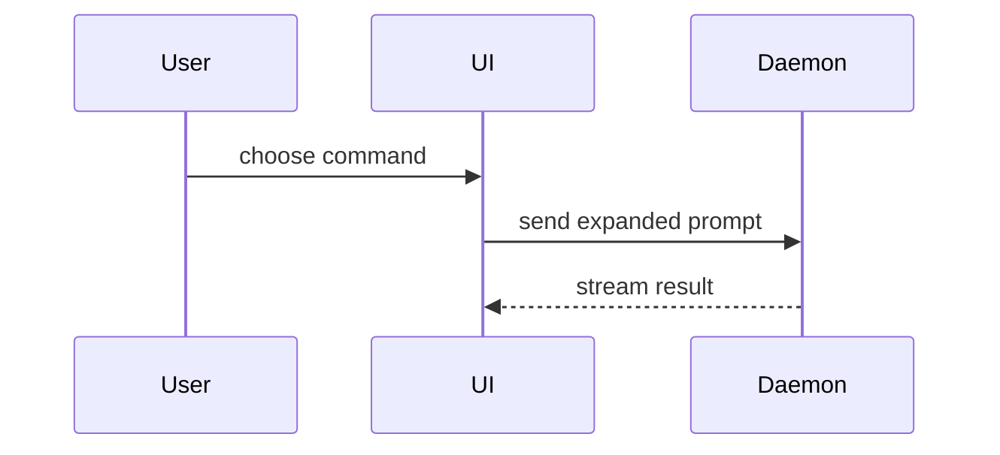

A PR body is read by someone deciding whether to merge.
Put what they must care about on one screen, in this order: what changes, the proof it works, what they must do.
Everything else goes under `<details>`: it stays on record for the next agent without being in the reader's way.

````markdown
<One or two sentences: what changes for the reader, in their words. Closes #n.>

## Summary

<the smallest visual that shows the change: a diff sketch, a tree, a call tree or Mermaid>

## Evidence

- **Before:** <the failing run, output or screenshot>
- **After:** <the passing run, output or screenshot>

## Needs you

<Optional: one plain-English sentence per item the owner must do or decide. No such item, no section.>

<details>
<summary>Prompt for your local agent</summary>

```text
<only for work on the owner's machine: a copy-paste prompt for their local agent>
```

</details>

<details>
<summary>Decisions, verification, notes</summary>

<decisions with their reasoning, the full verification list, what was not verified, notes>

</details>
````

## Rules

- **One screen.** At most about 25 lines outside `<details>`; no paragraphs there, one line per bullet.
- **Evidence is runs, not adjectives:** the command and its counts (`make check: exit 0; 199 passed`), or a screenshot when the change is visual.
  Show the test that failed before and passes after, as pseudocode when the code is long.
- **Needs you is optional and appears only when it holds a real item:** an action or a decision the PR waits on.
  Never fill it with a no-op ("merge when you're happy", "nothing to verify locally", "no action needed"): merging needs no invitation (the owner's call, or an agent's once the `review` skill's records pass on the head), and an empty section is noise.
- **Needs you speaks to the owner,** one plain-English sentence per item, with commands kept out of the sentence.
  A decision or an approval is the sentence alone; the owner answers on the PR.
  Work on the owner's machine (a run, a build, a check on their cluster, an edit to their local config) is work for their **local agent**: follow the sentence with a `Prompt for your local agent` block.
  The prompt stands alone: the repo and branch, the steps, and what done looks like.
  It asks for a report (a PR comment with the result, or an issue on failure) only when this PR waits on that result; otherwise the local agent does the work and stops.
- **Merge danger only when it bites.** A change that is hard to undo (a data migration, a deletion, a public interface, something published) gets one line under `Needs you`: `**One-way door:** <why>`.
  Easy-to-revert changes say nothing about it.
- **A stacked PR targets the PR below it** and is retargeted to `main` when that one merges: one targeting `main` early carries the lower PR's commits into its own merge.
  Say in its first line which PR must merge first.
- **Required sections stay short.** When the repo asks for named sections (decisions, open questions), keep each as one-line bullets outside `<details>` and put the reasoning inside.
- **Details hold the rest:** decisions and why, rejected options, the full verification list, what could not be verified, follow-ups filed.
  Several `<details>` blocks are fine when the topics differ.
  Leave a blank line after `<summary>…</summary>` or GitHub renders the Markdown as plain text.
- **Session outputs outlive the session on the issue,** not in the body: a plan, an analysis or a visual the next person needs goes as an artifact on the issue the PR closes (the `issue` skill); the body links to it at most.
- Skip preambles. Use the repo's domain language (its `GLOSSARY.md` or its architecture document's terms).
- Editing an existing body follows the same shape; rewrite a wall of text into it rather than appending.

## Sections

### Summary

Pick the smallest view that makes the key point clear.

- Show logic or an algorithm as pseudocode:

```text
on(save)
  if content is unchanged
    return cached result
  write new content
  return fresh result
```

- Show runtime control flow as a call tree:

```text
submitForm
  createSession
    persistPrompt
    launchAgent
  navigateToSession
```

- Show UI structure as a component tree, including state and module boundaries that matter:

```text
<SessionPage> (apps/example/src/routes/session.tsx)
  useSessionEvents()
  <SessionToolbar>
    <RunSkillButton> (packages/ui)
```

- Show file responsibility or a broad refactor as a shallow file tree:

```text
src/
├── commands/       # parses user actions
├── sessions/       # owns session state
└── transport/      # sends API requests
```

- Show component interaction, control flow, or data flow with Mermaid:



- Use `diff` when the point is what changes and the surrounding shape already exists. Match the diff shape to the topic.

For a component change:

```diff
 <SessionPage>
   useSessionEvents()
   <SessionToolbar>
+    <RunSkillButton />
   <SessionTimeline>
+    <SkillResultCard />
```

For a file-layout change:

```diff
 src/
 ├── commands/
+│   └── show-me.ts       # expands the slash command
 ├── sessions/
-└── transport.ts
+└── transport/
+    ├── client.ts
+    └── stream.ts
```

For a call-tree or call-stack change:

```diff
 submitForm
   createSession
     persistPrompt
+    expandSkillMention
     launchAgent
-  navigateToSession
+  navigateToSession
+    subscribeToEvents
```

For a state or control-flow change:

```diff
 on(save)
-  write content
+  if content is unchanged
+    return cached result
+  write new content
+  invalidate cache
```

- Show the whole block when most of it is new, when omitted context would hide ownership or order, or when the user needs a copyable target shape:

```ts
function expandSkill(command: string): string {
  const skillName = command.slice(1);
  return `use the ${skillName} skill`;
}
```

#### Guidance

Place each visual next to the short text it supports. Keep only the calls, files, props, states, and boundaries needed to answer the user's current question or the options to resolve the current discussion point.

You may use one of these, you may use several, it is unlikely you will use all of them. Use your judgement and don't overwhelm the user.

### Evidence

Concrete evidence that the change works. Show a before and after.

Screenshots are S-tier - when the environment is set up for it and the change is visual.

- **Show the change, not the whole picture.** For a visual change (a diagram, a page, a chart), crop the region that changed and show it before and after, same view, theme and scale, side by side in a table or stacked when wide; a new picture shows the part a reviewer must judge, and links the full file.
- **Host images by commit.** The REST API cannot attach images to a body: commit the crops on the PR's branch under `.pr-images/<pr>/`, remove them in the next commit, and link them by the first commit's SHA (`blob/<sha>/<path>?raw=true`), so they outlive the merge and never reach the tree.
- **A public repo never hosts a private one's content,** in a commit, an image or a link: check both repos' visibility first, and draw the evidence from public material.

Execution-based evidence is A-tier. Test results, console output. Show the exact test that now fails and passes, using pseudocode.
